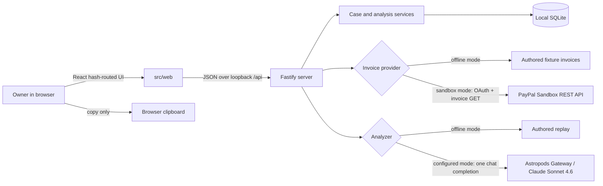

# Payment Resolution Desk architecture

## What it is

Payment Resolution Desk is a single-owner local web application for reviewing an unpaid or partially paid PayPal invoice beside synthetic customer correspondence, recording evidence-backed findings, and preparing a reply for the owner to copy and send outside the app. The checkout contains an active local prototype with an offline demonstration mode and opt-in PayPal sandbox/Astropods integration; it contains no hosting or production deployment configuration. This description is based on source only and does not assert that any deployment or provider connection is currently live or healthy; dated live evidence belongs in the workspace's [`docs/PROJECT-STATE.md`](../../../docs/PROJECT-STATE.md).

## System overview

The runtime is Node.js 24 and TypeScript. React 19 and Vite provide the browser interface, Fastify 5 provides the loopback HTTP API, Node's built-in `node:sqlite` stores the workspace, Zod validates commands and provider/model data, and Playwright/Vitest cover browser and lower-level behavior.



`src/server/main.ts` loads configuration, opens the database, seeds either the three fixture cases or allowlisted sandbox case shells, builds the Fastify app, and serves the compiled client when `dist/client` exists. `src/server/app.ts` selects the invoice and analysis adapters, restricts fixture cases to the fixture environment and synthetic studio merchant, and restricts sandbox cases to the configured environment, merchant, and invoice allowlist. The server binds only to `127.0.0.1`; `src/server/http/local-guard.ts` also rejects foreign hosts, cross-origin mutations, and non-JSON writes.

The application talks to two external services only when explicitly configured:

| Service | Purpose | Code boundary |
| --- | --- | --- |
| PayPal Sandbox REST API | Obtain an OAuth token and read an allowlisted invoice. No invoice or payment write endpoint exists. | `src/server/invoices/paypal-provider.ts`, `PayPalProvider.read()` |
| Astropods Gateway | Request one structured analysis from `claude-sonnet-4-6`. The model receives synthetic sources and an invoice snapshot but no tools. | `src/server/analysis/astropods-analyzer.ts`, `AstropodsAnalyzer.analyze()` |

The fixture provider and mock analyzer implement the same ports for an offline workflow. The browser clipboard is the only operating-system integration; copying does not send a message.

## How a request or run flows

### Startup and case discovery

1. `src/server/main.ts` requires Node 24, calls `loadConfig()` in `src/server/config.ts`, and opens the configured SQLite file through `openDatabase()` in `src/server/db/database.ts`.
2. Fixture mode calls `seedDemo()` in `src/server/demo/seed.ts`. Sandbox mode calls `seedKnownSandboxCases()` in `src/server/invoices/known-cases.ts`, which creates an empty case shell for each configured invoice ID without calling PayPal.
3. `buildApp()` in `src/server/app.ts` selects `FixtureProvider` or `PayPalProvider`, plus `MockAnalyzer`, `AstropodsAnalyzer`, or `UnavailableAnalyzer`.
4. `src/web/App.tsx` fetches `/api/status` and renders the hash-routed queue, invoice list, activity list, status panel, or a case workspace. `QueuePage.tsx` calls `api.getCases()`; selecting a case opens `#case/{caseId}`.

### Refreshing invoice facts

1. `CasePage.tsx` calls `api.refresh()` in `src/web/api.ts`, which posts to `/api/cases/:id/refresh`.
2. `InvoiceRefresh.refreshForPrerequisite()` in `src/server/invoices/refresh.ts` reads through the selected provider with an eight-second outer deadline and rejects an older response if a newer refresh has started.
3. In sandbox mode, `PayPalProvider.read()` obtains or reuses an OAuth token, performs only `GET /v2/invoicing/invoices/{id}`, and passes the response to `normalizePayPalInvoice()` in `src/server/invoices/normalize.ts`.
4. The normalizer accepts only the allowlisted invoice identity, USD or SGD, consistent exact-cent balances, supported statuses, no refund structure, and unique supplied payment IDs, and it retains only a tightly restricted sandbox payment URL.
5. `InvoiceRefresh` saves an accepted snapshot and an activity event. A changed financial fingerprint increments the case version and invalidates reviewed drafts. A failed read preserves the last snapshot but marks it stale (or missing), records a failure event, and prevents review/copy prerequisites.

Fixture-only state changes use `/api/demo/cases/:id/transition`, registered by `src/server/demo/routes.ts`. They are labelled simulations and are unavailable in sandbox mode.

### Adding evidence and findings

1. `SourcesPane.tsx` and `FindingsPane.tsx` build a `CaseCommand` and send it through `api.command()` to `/api/cases/:id/commands`.
2. `CaseService.applyCommand()` in `src/server/cases/service.ts` validates the command with `CaseCommandSchema` from `src/shared/schemas.ts`.
3. Source text is stored as a new immutable version. Cases are limited to ten active sources and 30,000 total characters. Replacements keep the old source version for history.
4. Evidence cited by owner findings must be an exact immutable UTF-16 source span or an invoice snapshot fingerprint. `validEvidence()` in `src/server/cases/evidence.ts` rejects citations that do not match stored evidence.
5. `CaseRepository.transactCommand()` in `src/server/db/case-repository.ts` uses an immediate SQLite transaction, optimistic `expectedVersion`, and caller-generated `operationId`. Replaying the same operation is idempotent; reusing its ID with another payload is a conflict.

### Running analysis

1. `CasePage.tsx` calls `api.analyze()`, which posts to `/api/cases/:id/analyze` and reaches `AnalysisService.runAnalysis()` in `src/server/analysis/service.ts`.
2. The service fingerprints active source versions, invoice facts, analyzer mode, and analyzer revision. It reuses a saved result for an unchanged fingerprint and coalesces concurrent identical runs.
3. `buildEvidenceCandidates()` in `src/server/analysis/validate.ts` enumerates exact source passages and permitted invoice fields before an analyzer runs.
4. Offline mode's `MockAnalyzer.analyze()` in `src/server/analysis/mock-analyzer.ts` replays authored suggestions only when the original fixture evidence and invoice fingerprint still match.
5. Configured mode's `AstropodsAnalyzer.analyze()` sends one bounded request. It treats source text as untrusted, exposes no tools, permits no fallback or retry, bounds request/response sizes, checks the reported model, parses one JSON value, resolves only supplied candidate IDs, and validates the result.
6. Before saving, `AnalysisService.execute()` verifies that the case version, context hash, and input fingerprint did not change during the request. It appends unreviewed findings and a syntactically verified analysis record; it does not overwrite owner decisions or drafts.

### Saving, reviewing, and copying a reply

1. `DraftPane.tsx` saves an edited reply with the `draft.save` command. Each save creates an immutable `DraftVersion`; the latest version is the working draft.
2. `draft.review` first calls `CaseService.refreshContext()`. The invoice must refresh successfully and the evidence/payment context must remain identical during that read.
3. The review binds the exact draft text to a context hash covering the active sources, invoice snapshot, findings, and case status. `CaseRepository.transactCommand()` stores that immutable review context.
4. Copying is a two-phase action. `CaseService.prepareCopy()` refreshes again and issues a persistent copy permit only for the current, reviewed, non-stale draft. The browser writes the permit text with the Clipboard API.
5. Only after the browser reports success does `api.acknowledgeCopy()` call `/api/copy-permits/:id/ack`, which appends a `draft.copied` event. It records a copy, not a send. If acknowledgement fails after the clipboard write, the same permit can be acknowledged again without copying different text.
6. A separate `action.record` command can record the owner's statement that a draft was sent outside the app. Case status changes are also explicit owner commands; payment state never closes a case automatically.

### Reading history

`CaseTimeline.tsx` selects the historical entry, and `HistoricalEvidenceViewer.tsx` fetches immutable draft/review context from `/api/cases/:id/history/drafts/:draftVersionId` and invoice snapshots from `/api/cases/:id/history/invoices/:fingerprint`. Historical views use the stored sources and payment snapshot rather than reconstructing history from the current case.

## Data

All durable server-side case and history state is in one local SQLite database. Fixture mode defaults to `.local/payment-resolution.sqlite`, `npm run demo` uses `.local/demo.sqlite`, and configured sandbox mode defaults to `.local/payment-resolution-sandbox.sqlite`. `DATABASE_PATH` or `DEMO_DATABASE_PATH` can select another file. SQLite uses WAL journaling and a five-second busy timeout.

The `cases.detail` JSON document is the current aggregate. The other tables preserve immutable material needed for history and idempotency:

| Table | Contents |
| --- | --- |
| `cases` | One current `CaseDetail` aggregate per case, including current invoice state, all source/draft/activity arrays, findings, and the latest analysis. |
| `sources` | Every immutable source version, keyed by case, logical source ID, and version. Update and delete triggers reject mutation. |
| `drafts` | Every immutable saved draft version. An update trigger rejects mutation. |
| `snapshots` | Accepted invoice snapshots, including their semantic financial fingerprint and fetch time. An update trigger rejects mutation. |
| `activity` | Append-only case events. Update and delete triggers reject mutation. |
| `operations` | Operation IDs, payload hashes, and resulting activity IDs used to deduplicate commands and copy acknowledgements. |
| `copy_permits` | Exact reviewed text and context authorized for a browser clipboard write. |
| `review_contexts` | Immutable reviewed source IDs, invoice snapshot, findings, status, draft, and review time, keyed by context hash. |

`src/server/db/migrations/001.sql` is the only schema file. `openDatabase()` executes it on every open using `CREATE TABLE IF NOT EXISTS`; there is no migration-version table or ordered migration runner. Schema changes therefore require a new migration mechanism or a deliberately backward-compatible update to the current bootstrap file.

The evaluation runner is separate from application state. `scripts/evaluate.ts` reads authored JSON cases from `fixtures/evaluation/` and writes private run directories under `.local/evaluations/`. The committed `docs/evaluation-results/` files are sanitized summaries/results, not a runtime store or cache.

## Code map

| Path | Responsibility |
| --- | --- |
| `src/server/main.ts` | Process entry point, seeding, static client serving, signal shutdown, and loopback listen. |
| `src/server/app.ts` | Fastify composition, environment visibility boundary, common routes, and adapter selection. |
| `src/server/config.ts` | Environment parsing and opt-in gates for sandbox and Astropods modes. |
| `src/server/cases/` | Case commands, evidence validation, review/copy prerequisites, and history routes. |
| `src/server/db/` | SQLite open/bootstrap and the transactional case repository. |
| `src/server/invoices/` | Fixture and PayPal adapters, provider normalization, refresh ordering, and known sandbox case seeding. |
| `src/server/analysis/` | Analyzer interface, authored replay, Astropods adapter, output validation, caching, and persistence. |
| `src/server/demo/` | Three authored cases and fixture-only payment-state simulations. |
| `src/server/http/` | Local-request guard and abort-based deadlines. |
| `src/shared/contracts.ts` | Shared domain types for invoices, evidence, findings, drafts, activity, commands, and analysis. |
| `src/shared/schemas.ts` | Zod validation for financial values, citations, findings, and commands. |
| `src/web/App.tsx` | Application shell and hash routing. |
| `src/web/api.ts` | Browser API client, error normalization, labels, and money/time formatting. |
| `src/web/features/case/` | The review workspace: payment header, findings, sources, draft actions, and immutable history. |
| `src/web/features/queue/`, `invoices/`, `activity/`, `settings/` | Top-level list and status views. |
| `scripts/start-demo.mjs` | Forces fixture/mock mode and an isolated demo database, ignoring inherited integration modes. |
| `scripts/evaluate.ts` | Dry-run or explicitly live synthetic model evaluation and private result capture. |
| `scripts/validate-evaluation.ts` | Validates the 24-case fixture manifest, split, identities, and exact answer spans. |
| `fixtures/demo/` | Authored records for the three offline cases. |
| `fixtures/evaluation/` | Twelve development and twelve held-out authored evaluation cases plus separate answer files. |
| `tests/unit/`, `tests/integration/`, `tests/ui/` | Vitest coverage for validation, services/adapters/persistence, and React behavior. |
| `tests/e2e/` | Serialized Playwright journeys against an isolated server on port 4318. |
| `spikes/local-scope/` | Historical local-model classification experiment; it is not used by the application runtime. |
| `docs/judge-guide.md` | Complete offline/configured setup, evaluation, and source-release guidance. |

## Configuration and secrets

`.env.example` is the template. The application does not load `.env` by itself: `npm run start:configured` uses Node's `--env-file=.env`; `npm start` uses only the existing process environment. Secret values must remain in the ignored `.env` file and are never needed by the browser.

| Name | Controls | Source/default |
| --- | --- | --- |
| `PORT` | Loopback API/static-server port. Only `4317` and the test port `4318` are accepted. | Process environment; default `4317`. |
| `APP_MODE` | `fixture` or `paypal_sandbox` invoice environment. | Process environment; default `fixture`. |
| `ANALYSIS_MODE` | `mock`, `unavailable`, or `astropods`. Mock is allowed only with fixture invoices. | Process environment; defaults to `mock` in fixture mode and `unavailable` in sandbox mode. |
| `DATABASE_PATH` | Ordinary application SQLite file. | Process environment; otherwise mode-specific `.local/` path. |
| `DEMO_DATABASE_PATH` | SQLite file used only by `npm run demo`. | Process environment; default `.local/demo.sqlite`. |
| `PAYPAL_MERCHANT_ID` | Internal local scope label used to bind cases to the configured sandbox account. It is not a PayPal-issued merchant ID. | `.env`; example `paypal-sandbox-business`. |
| `PAYPAL_CLIENT_ID` | PayPal sandbox OAuth client identifier. | Private `.env`/owner's PayPal sandbox app. |
| `PAYPAL_CLIENT_SECRET` | PayPal sandbox OAuth secret. | Private `.env`/owner's PayPal sandbox app. |
| `PAYPAL_INVOICE_IDS` | Comma-separated allowlist of at most 20 unique `INV2-...` invoice IDs. | Private `.env`/known sandbox records. |
| `PAYPAL_SETUP_APPROVED` | Enables sandbox configuration only when exactly `true`; incomplete approved setup fails startup. | `.env`; default/example `false`. |
| `ASTRO_GATEWAY_URL` | Astropods host. The adapter accepts only `https://aig.astropods.ai`. | `.env.example`. |
| `ASTRO_GATEWAY_API_KEY` | Server-side Astropods Gateway credential. | Private `.env`/owner's Gateway account. |
| `ASTROPODS_SPONSOR_CREDITS_VERIFIED` | Required opt-in assertion before Astropods analysis is enabled. | `.env`; default/example `false`. |
| `SYNTHETIC_DATA_APPROVED` | Required opt-in assertion that the supplied synthetic data may be sent for analysis. | `.env`; default/example `false`. |
| `PLAYWRIGHT_BROWSERS_PATH` | Browser-binary location for Playwright tests. | `playwright.config.ts` forces `.local/browsers`. |

`vite.config.ts` runs the development client at `127.0.0.1:5173` and proxies `/api` to port 4317. `playwright.config.ts` serializes browser tests against port 4318. `.node-version` pins Node 24.14.0, while `package.json` accepts Node 24.x.

## Error handling and failure modes

- Configuration fails closed. Invalid mode, port, allowlist, missing approved credentials, a foreign Gateway URL, or missing analysis approvals prevents the relevant configuration from loading.
- The local guard returns `403 LOCAL_REQUEST_ONLY` for an unapproved host or cross-origin/non-JSON mutation. The app-level visibility hook returns 404 rather than exposing a case from another environment, merchant, or allowlist.
- Case commands validate before mutation and run inside `BEGIN IMMEDIATE`. Version/context conflicts return HTTP 409; validation errors return 400; unavailable dependencies return 503. Transaction exceptions roll back.
- PayPal authorization and reads are bounded. The invoice GET may make at most three attempts for 429/5xx responses with a delay of at most two seconds. Authentication/authorization/404 and unsupported data do not loop. A failure retains the last accepted facts, marks them stale or missing, records an activity event, and blocks review/copy. The manual refresh endpoint still returns the current case rather than a non-2xx response, so callers must inspect `invoice.error` and `invoice.freshness`.
- Astropods receives one request with a 14-second adapter deadline inside a 15-second service deadline. There is no retry or fallback. HTTP failures, timeout, excessive response size, malformed JSON, model substitution, unknown citations, or schema violations leave saved owner work unchanged.
- Analysis and review use version/context checks after slow work. If evidence, payment facts, or a draft changes while a request is running, the result is rejected instead of being applied to the new context.
- The browser preserves unsaved draft/source/finding text across unrelated refreshes and exposes version conflicts for comparison. Clipboard failure does not create a copied event; acknowledgement failure leaves a retryable permit.
- Unexpected Fastify errors are converted to a generic `500 REQUEST_FAILED`. Because `buildApp()` sets `logger: false`, the server does not log the underlying request exception; see Known issues.
- SQLite opening, schema execution, seeding, or configuration failures occur before the listen error handler. They terminate startup rather than serving a partially initialized app.

## Running, testing and releasing

Run commands from the repository root. Install with the committed lockfile:

```sh
npm ci --ignore-scripts --no-audit --no-fund
```

| Goal | Command | Result |
| --- | --- | --- |
| Develop client and server | `npm run dev` | Watches `src/server/main.ts`, serves Vite on 5173, and proxies to the API on 4317. |
| Build | `npm run build` | Writes the Vite client to `dist/client` and server JavaScript to `dist/server`. |
| Run the offline demo | `npm run demo` | Requires a prior build; forces fixtures/mock analysis and uses the demo database. |
| Run built defaults | `npm start` | Requires a prior build; uses the current process environment and does not load `.env`. |
| Run configured sandbox/AI mode | `npm run start:configured` | Requires a prior build and loads `.env`. Follow `docs/judge-guide.md` first. |
| Unit, integration, and UI tests | `npm test` | Runs Vitest serially. Provider transports are mocked/injected. |
| Type check | `npm run typecheck` | Checks source, scripts, and tests without emitting files. |
| Browser tests | `npm run test:e2e` | Runs serialized Playwright journeys on the isolated fixture server/port. |
| Validate evaluation fixtures | `npm run eval:validate` | Validates the 24 authored cases without inference. |
| Prepare an evaluation run | `npm run eval:run` | Writes a held-out dry-run plan under `.local/evaluations/`; it makes no model request without `--live`. |

The configured setup, explicit live-evaluation commands, browser installation fallback, and source-release/submission package are documented in [`docs/judge-guide.md`](docs/judge-guide.md). There is no deployment script, container, CI workflow, or hosting manifest in this checkout; the repository release guidance is for a local source package.

## Known issues and gotchas

### Unexpected API failures have no server-side diagnostic

**What happens:** `buildApp()` turns unexpected handler exceptions into the same generic 500 response, and Fastify logging is disabled. The owner sees only “The request could not be processed,” while the terminal receives no request-level cause. **Where:** `src/server/app.ts`, `buildApp()` (`Fastify({ logger: false })` and `setErrorHandler`). **Why it matters:** malformed local state or an unanticipated code error is difficult to distinguish and diagnose. **Likely fix:** enable a redacting local logger or log a generated error ID and safe stack/cause server-side while keeping provider bodies and credentials out of responses.

### “Sent outside the app” can be recorded for an unreviewed draft through the API

**What happens:** the `action.record` branch checks only that the referenced draft exists. It does not require `reviewedAt`, a current context hash, or a non-stale draft. **Where:** `src/server/cases/service.ts`, `CaseService.applyCommand()` in the `action.record` case. **Why it matters:** a direct local API caller can create an activity statement that implies an old or unreviewed reply was sent; the app still does not send anything itself. **Likely fix:** require an exact reviewed context (or a permit-like token) for the recorded draft, or rename and constrain the event contract if it is intentionally only an unrestricted owner note.

### Persistent history and copy permits have no retention policy

**What happens:** every new source, draft, activity entry, fetched snapshot, operation, review context, and copy permit remains in SQLite. Snapshot IDs include a hash of the full snapshot, including `fetchedAt`, so repeated semantically identical refreshes can add rows. **Where:** `src/server/db/case-repository.ts`, `persistVersions()` and `putCopyPermit()`; `src/server/db/migrations/001.sql`. **Why it matters:** a long-running or larger workspace grows indefinitely and retains synthetic/history content until the database is manually archived or removed. **Likely fix:** define retention requirements, add measured cleanup/archival for expired permits and redundant snapshots, and preserve any audit records the owner explicitly needs.

### The schema bootstrap is not a migration system

**What happens:** `001.sql` runs on every open with `CREATE TABLE IF NOT EXISTS`, but there is no schema version or upgrade sequence. Changing an existing table definition in that file will not update an older database. **Where:** `src/server/db/database.ts`, `openDatabase()`, and `src/server/db/migrations/001.sql`. **Why it matters:** a future checkout can work with a fresh database but fail or behave differently with an existing owner database. **Likely fix:** add a schema-version table and ordered, transactional forward migrations before the first incompatible schema change.

### Runtime paths assume the repository root is the working directory

**What happens:** migration SQL, compiled client files, fixture JSON, and default database paths are resolved from `process.cwd()`. Starting the compiled entry point from another directory can miss the migration/client/fixtures or place data in an unexpected `.local` directory. **Where:** `src/server/db/database.ts`, `src/server/main.ts`, `src/server/demo/seed.ts`, and `src/server/config.ts`. **Why it matters:** service wrappers or IDE launch profiles that use a different working directory can fail even with a valid build. **Likely fix:** resolve packaged assets relative to `import.meta.url` and make the data root explicit; until then, run every documented command from the repository root.

### Model citations are structurally valid, not semantically certified

**What happens:** validation proves that cited spans exist and that output follows the schema, but it cannot prove that a passage supports the model's interpretation or suggested reply. The stored analysis explicitly records `verification: "syntactic_only"`. **Where:** `src/server/analysis/validate.ts`, `validateAnalysis()`, and `src/server/analysis/service.ts`, `AnalysisService.execute()`. **Why it matters:** accepted-looking model output can still misclassify a dispute or add an unsupported next step, as the committed evaluation report shows. **Likely fix:** keep mandatory owner decisions and editing; improve evaluation/prompting or add a separately validated semantic check before considering any broader automation.

### Real customer data is outside the implemented trust model

**What happens:** the local SQLite database is not encrypted, there is no user authentication or multi-tenant authorization, sources are required to have synthetic provenance, and retained history has no deletion UI. **Where:** `src/server/db/database.ts`, `src/server/http/local-guard.ts`, `src/server/analysis/astropods-analyzer.ts`, and the source contract in `src/shared/contracts.ts`. **Why it matters:** loopback/host checks protect the local prototype boundary but are not production access controls. **Likely fix:** design authentication, authorization, encryption, data classification, retention/deletion, and deployment controls before allowing real customer data or remote access.
